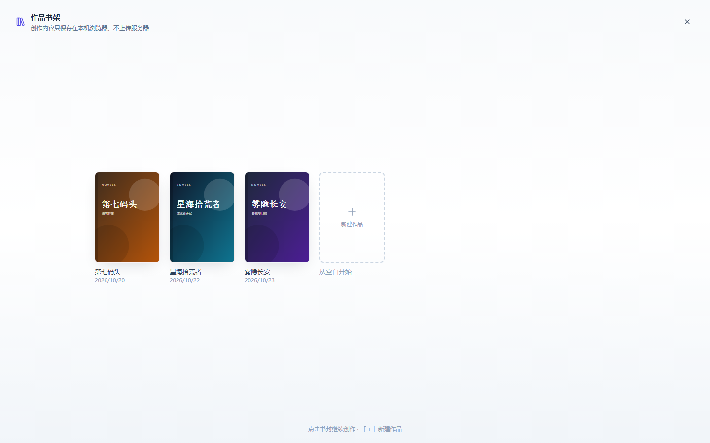
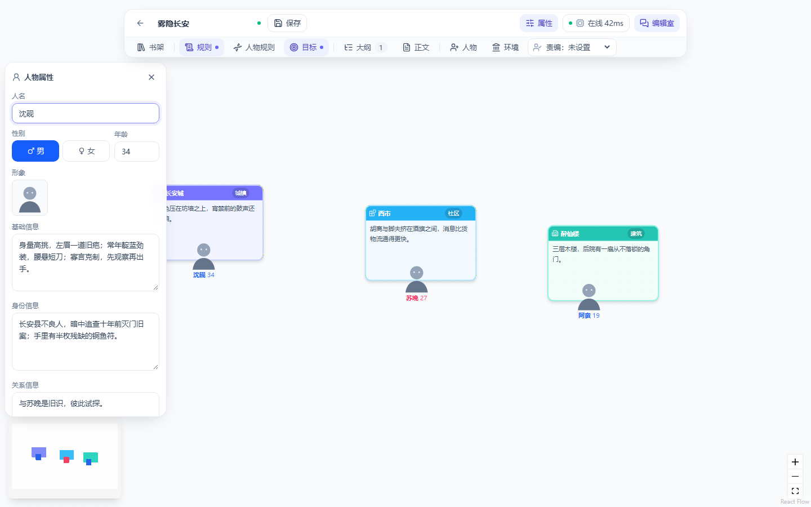

# novels-studio · AI 小说创作台

[](LICENSE)

一个本地优先的 AI 长篇小说创作工作台：用节点画布搭建人物、环境、卷与章节，配合大纲/正文管理器、AI 编辑室和多编辑记忆系统，把「设定 → 大纲 → 正文」串成一条可迭代的创作流水线。

> An AI-assisted long-form fiction studio built with React, TypeScript and React Flow. Local-first by default; optional OpenAI-compatible text, image and video backends.

| 作品书架 | 创作台画布 |
| --- | --- |
|  |  |

## 功能

- **作品书架**：所有作品以书封陈列，支持封面、重命名、多存档与快速切换；作品数据保存在浏览器本机。
- **节点画布**：人物 / 环境 / 区域 / 卷 / 章节节点自由连线；环境可嵌套（城市 → 建筑 → 房间），拖拽即调整层级。
- **属性面板**：未选中节点时显示「本书属性」（书名、封面、作品概览）；选中人物可编辑基础信息（长相/身材/穿搭/性格）、身份信息与关系；环境可编辑类型与描述。
- **大纲管理器**：卷 → 章节的树状结构，支持 AI 生成卷纲、章节大纲与章节需求。
- **正文管理器**：按大纲逐章生成、续写与润色；阅读视图提供四套主题、字号调节与舒适排版。
- **编辑室**：与总编辑或多个编辑分别对话，AI 产出的【人物设定】【环境设定】【章节大纲】【正文】等块可一键落为画布节点或章节。
- **编辑部与记忆**：每个编辑拥有独立技能记忆（八份 markdown 模板），调教内容按模板小节沉淀；会议模式支持多编辑共同讨论。
- **模型中心**：文本模型、正文执笔引擎、推理强度与生图模型统一配置；支持私有 OpenAI 兼容端点与公共中转双轨。
- **视觉素材**：人物肖像、立绘、配图与封面；可接自建 ComfyUI 或兼容的生图/视频服务。
- **本地优先**：画布与存档默认只写浏览器 localStorage，不上传服务器；API Key 只保存在服务端配置文件。

## 快速开始

### 环境要求

- Node.js ≥ 20（推荐 22）
- pnpm ≥ 9（推荐 10）
- Python ≥ 3.10（仅本地运行后端时需要）
- 现代浏览器（Chrome / Edge / Firefox / Safari 最近两个大版本）

### 本地运行

```bash
pnpm install
python -m pip install -r requirements.txt

# 可选：配置模型与生图服务（不配置时画布/存档仍可使用，AI 功能会提示未配置）
cp qwenconfig.example.json qwenconfig.json
cp scriptconfig.example.json scriptconfig.json
cp imgconfig.example.json imgconfig.json
cp vidconfig.example.json vidconfig.json

python server.py            # 后端 http://127.0.0.1:8768
pnpm dev                    # 前端 http://localhost:5173/studio.html
```

打开 <http://localhost:5173/studio.html>。Vite 会把 `/api` 代理到本机 `server.py`。

也可以先构建再由 `server.py` 直接提供页面：

```bash
pnpm build
python server.py            # 打开 http://127.0.0.1:8768/
```

## 配置

以下文件都已被 `.gitignore` 排除，**只放在服务端**，不要提交：

| 文件 | 用途 | 关键字段 |
| --- | --- | --- |
| `qwenconfig.json` | 文本模型（私有/公共双轨） | `base_url`、`model`、`api_key`、`public.{base_url,api_key,model}` |
| `scriptconfig.json` | 脚本生成（OpenAI chat 协议） | `base_url`、`api_key`、`model_list` |
| `imgconfig.json` | 生图（公共中转 / 私有 ComfyUI） | `default`、`public.{base_url,api_key,model_list}`、`private.{base_url,model}` |
| `vidconfig.json` | 视频生成（ComfyUI 工作流） | `base_url`、`token`、`workflow_*` |

配置模板见根目录 `*.example.json`。服务端读取配置后，前端只能看到打码后的 Key；所有上游请求由 `server.py` 代理。

文本模型需要兼容 OpenAI Chat Completions；公共轨支持 OpenAI Responses API 中转。生图公共轨需要兼容 `/draw` + 任务轮询协议，私有轨使用 ComfyUI 标准 txt2img 工作流。

## 数据与隐私

- 作品画布、命名存档、封面、编辑室对话与编辑记忆保存在**浏览器 localStorage**，刷新/关闭浏览器不丢失；换域名或清理站点数据会重置。
- 服务端仅在必要时保存生成结果与人物素材（`images/`、`videos/`、`audiofiles/`、`charassets/`），这些目录均不进入 Git。
- API Key 只写服务端配置文件，接口返回时打码；前端代码不含任何密钥。
- 项目不包含遥测或第三方统计。

## 部署

`scripts/deploy.sh` 提供一条参考部署链路：构建 → 上传 `server.py` 与 `dist/` → 重启 8768 → 冒烟验证。

```bash
cp .env.example .env        # 填入服务器地址、用户、远端目录、子路径
bash scripts/deploy.sh
```

部署前请确认：

- nginx（或其它反向代理）把站点子路径转发到 `server.py`，例如 `/novels-studio/` → `http://127.0.0.1:8768/`。
- 配置文件与数据目录位于服务端且权限收紧（`chmod 600 *.json`）。
- 生产环境建议启用 HTTPS。

## 项目结构

```
studio.html                  前端入口
src/entries/studio.tsx       应用挂载
src/components/studio/       画布、书架、属性、编辑室、大纲、正文、模型中心
src/components/ui/           设计系统原语
src/stores/                  Zustand 状态（画布 / 编辑室 / 编辑部 / UI）
src/engines/                 生成能力、会议与编辑记忆模板
src/services/                存档、封面、人物素材、生图/视频客户端
src/shared/                  文本模型客户端与共享生成逻辑
skills/editor-memory/        八份编辑记忆模板
server.py                    aiohttp 后端（静态资源 + API 代理 + 本地存储）
scripts/deploy.sh            参考部署脚本
```

## 开发

```bash
pnpm build        # tsc --noEmit && vite build
python -m py_compile server.py
```

CI 会在 push / PR 时执行 `pnpm install --frozen-lockfile && pnpm build`。

## 贡献

欢迎 Issue 与 Pull Request。提交前请：

1. 不提交任何真实 API Key、服务器地址或部署凭据；
2. 保持 `pnpm build` 通过；
3. 说明改动动机与验证方式（涉及 UI 的改动建议附截图）。

详见 [CONTRIBUTING.md](CONTRIBUTING.md) 与 [CODE_OF_CONDUCT.md](CODE_OF_CONDUCT.md)。安全问题请按 [SECURITY.md](SECURITY.md) 私下报告。

## 许可证

本项目以 [MIT License](LICENSE) 开源。第三方内容与许可见 [THIRD_PARTY_NOTICES.md](THIRD_PARTY_NOTICES.md)。
